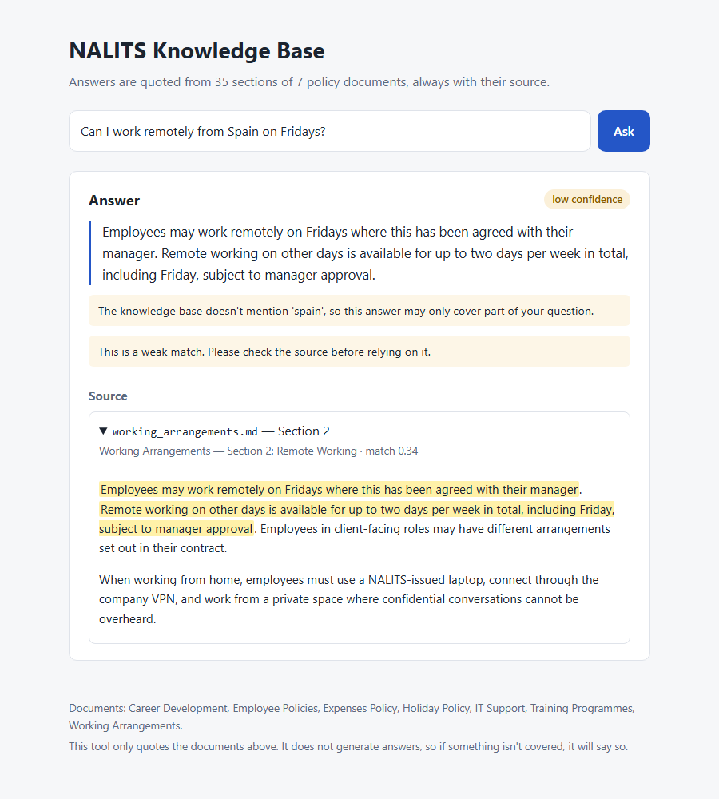
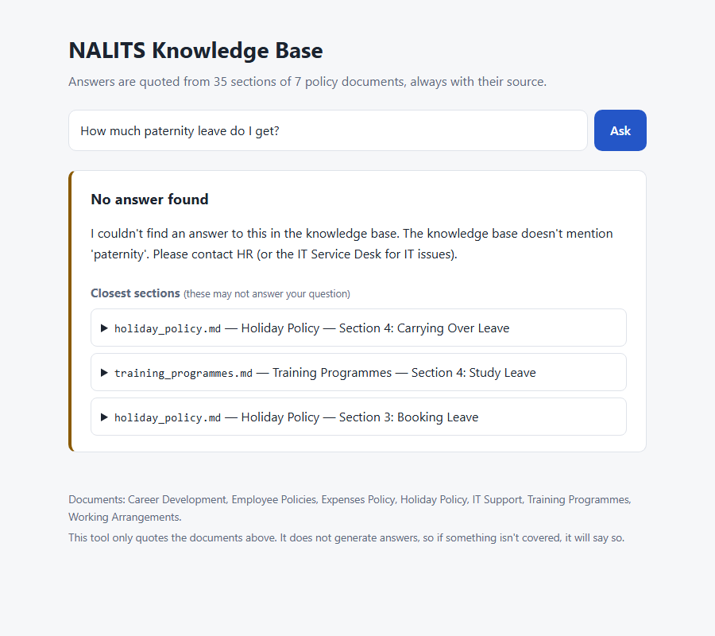

# NALITS Knowledge System

A small Python tool that answers employee questions from an internal knowledge base.
It **quotes the relevant policy text, always shows where it came from, and says so
when the documents don't cover a question** instead of guessing.

```text
$ python -m knowledge_system "Can I work from home on Friday?"
Answer:
  Employees may work remotely on Fridays where this has been agreed with their
  manager. Remote working on other days is available for up to two days per
  week in total, including Friday, subject to manager approval.

Confidence: high

Source:
  working_arrangements.md — Section 2
  (Working Arrangements — Section 2: Remote Working, score 0.43)
```

```text
$ python -m knowledge_system "How much paternity leave do I get?"
I couldn't find an answer to this in the knowledge base. The knowledge base
doesn't mention 'paternity'. Please contact HR (or the IT Service Desk for IT
issues).

Closest sections (these may not answer your question):
  - Holiday Policy — Section 4: Carrying Over Leave (holiday_policy.md)
  - Training Programmes — Section 4: Study Leave (training_programmes.md)
  - Holiday Policy — Section 3: Booking Leave (holiday_policy.md)
```

| Answer with a caveat and highlighted source | Out-of-scope question |
|---|---|
|  |  |

---

## Contents

1. [What I built](#what-i-built)
2. [Install and run](#install-and-run)
3. [How it works](#how-it-works)
4. [Key decisions and trade-offs](#key-decisions-and-trade-offs)
5. [Questions it cannot answer](#questions-it-cannot-answer)
6. [Testing and evaluation](#testing-and-evaluation)
7. [Project structure](#project-structure)
8. [Assumptions](#assumptions)
9. [Limitations](#limitations)
10. [What I would improve with more time](#what-i-would-improve-with-more-time)
11. [Final question: two weeks to production](#final-question-two-weeks-to-production-for-1000-employees)

---

## What I built

- **A search engine over 7 policy documents** (35 sections), using TF-IDF with stemming and a small synonym table.
- **Extractive answers.** The answer is the most relevant one or two sentences, copied word for word from the best section. Nothing is generated, so nothing can be invented.
- **A source on every answer.** Each answer cites the file, section number and section title. When two sections are almost equally relevant, both are cited.
- **Honest refusals.** Questions the documents don't cover are declined. The reply gives the reason, suggests who to contact and lists the closest sections.
- **Confidence labels and caveats.** Weak matches are marked *low confidence*, and any words in the question that the knowledge base doesn't contain are pointed out.
- **Three interfaces over the same core:** a CLI (one-shot, interactive and `--json`), a minimal web page, and a JSON API.
- **An evaluation set of 47 labelled questions** and a regression test that fails the build if search quality drops or an out-of-scope question gets answered.

## Install and run

Requires **Python 3.10+**.

```bash
git clone https://github.com/Azmath-Baig/ai-knowledge-system.git
cd ai-knowledge-system

python -m venv .venv
# Windows: .venv\Scripts\activate      macOS/Linux: source .venv/bin/activate

pip install -r requirements.txt
pip install -e .            # makes `python -m knowledge_system` and `kb` available
```

**Command line**

```bash
python -m knowledge_system "How many days of annual leave do I get?"
python -m knowledge_system                     # interactive mode; type 'quit' to exit
python -m knowledge_system --full "..."        # also print the whole source section
python -m knowledge_system --json "..."        # machine-readable output
python -m knowledge_system -v "..."            # log scores and decisions
```

**Web UI and API**

```bash
python -m knowledge_system --web               # open http://127.0.0.1:5000
curl "http://127.0.0.1:5000/api/ask?q=Can%20I%20WFH"
curl -X POST http://127.0.0.1:5000/api/ask -H "Content-Type: application/json" -d '{"question": "Can I WFH?"}'
```

**Tests and evaluation**

```bash
pytest                                         # 56 tests, ~3 seconds
python -m knowledge_system.evaluate -v         # per-question results and score distributions
```

To use a different set of documents, pass `--data path/to/folder` or set `KB_DATA_DIR`.

## How it works

```text
             ┌─────────────── once, at start-up ───────────────┐
data/*.md ──►│ loader.py: split on "## N. Heading" into sections │──► TF-IDF index (retriever.py)
             └─────────────────────────────────────────────────┘

question ──► text.py: lower-case, remove stop words, stem, add synonyms ("WFH" → "remote working")
         ──► retriever.py: cosine similarity against every section → top 3
         ──► answerer.py:  decide ─┬─ score too low, or most words unknown ──► NOT FOUND + reason + closest sections
                                   └─ otherwise ──► best 1–2 sentences, verbatim
                                                    + source(s) + confidence + caveats
         ──► cli.py / web.py: display
```

1. **Load** (`loader.py`). Each Markdown file is split on its `##` headings. A section is the unit that gets indexed and cited, so a citation always points somewhere a person can open and check.
2. **Index** (`retriever.py`). Every section becomes a TF-IDF vector over single words and word pairs. Headings are counted twice, because they are an author-written summary of the section.
3. **Process the question** (`text.py`). Documents and questions use the same tokenizer: lower-case, drop stop words (including generic ones like "policy" and "company"), then apply the Snowball stemmer, so "carry", "carrying" and "carried" all match. Informal terms such as "WFH", "PTO" and "reimburse" get the document's own vocabulary added.
4. **Retrieve.** Sections are ranked by cosine similarity, which always falls between 0 and 1.
5. **Decide** (`answerer.py`). The system answers, answers with caveats, or declines (see [below](#questions-it-cannot-answer)).
6. **Extract.** The sentences of the best section are scored against the question in the same TF-IDF space, and the top one or two are returned in their original order.

## Key decisions and trade-offs

| Decision | What I chose | Why | What I didn't choose, and why |
|---|---|---|---|
| Search method | **TF-IDF + cosine similarity** (scikit-learn) | Small corpus. Fast, deterministic and offline, with no API key or model download. Scores fall between 0 and 1, so the "I don't know" cut-off is easy to reason about and tune. I can explain every number it produces. | **BM25** usually ranks slightly better, but its scores have no fixed range, which makes a refusal threshold harder to set. **Embeddings** handle synonyms far better (see [Limitations](#limitations)), but they add a large model dependency and are harder to debug at this size. |
| Answer generation | **Extractive** (verbatim sentences) | Cannot hallucinate, and every word can be traced to a source. For HR policy, a correct quote matters more than a fluent paraphrase. | **LLM-generated answers** read better but can invent or blend facts, need an API key, cost money per question, and make tests non-deterministic. I would add one only as an optional layer restricted to the retrieved text (see [improvements](#what-i-would-improve-with-more-time)). |
| Chunking | **One chunk per `##` section** | Matches how the authors organised the content, and gives a meaningful citation ("Section 2: Remote Working"). | **Fixed-size chunks** cut sentences in half and turn citations into "characters 1,200–1,700". |
| Stemming | **Snowball stemmer** | Tiny, pure Python, rule-based. I tried simple plural stripping first, but it missed "-ing" and "-ed" forms ("carry over holiday" was wrongly refused). | **Lemmatisation** (spaCy/NLTK) is more accurate, but needs a much larger dependency and downloaded models. |
| Synonyms | **Small hand-written table** | Fixes the most common informal terms (WFH, PTO, reimburse) cheaply and transparently. | Embeddings solve this generally. The table is a deliberate stop-gap and is documented as one. |
| UI | **Server-rendered Flask page with no JavaScript** | The brief says a fancy UI isn't needed. The UI is a thin layer, and all behaviour lives in the tested core. It uses GET `?q=` URLs, so answers can be shared as links. | **Streamlit** is quicker to build but pulls in a heavy dependency stack and hides the HTTP layer. **React** would be overkill. |
| Frameworks | **No LangChain or vector database** | The core search-and-answer logic is about 350 lines of plain Python that I can explain line by line. | These are useful at scale, but here they would hide the decisions the brief asks me to explain. |

## Questions it cannot answer

A confident answer without a real source is the most dangerous thing this tool could produce. When unsure, it **declines rather than guesses**, but it still tries to help:

| Situation | Behaviour |
|---|---|
| Best match scores below `MIN_SCORE` (0.18) | **Not found.** Gives the reason, suggests contacting HR or the IT Service Desk, and lists the closest sections, clearly labelled as possibly irrelevant. Only sections that reach `MIN_SCORE` are listed: one that merely shares a word (e.g. "salary" in an expenses section) is noise. |
| Half or more of the question's key words never appear in the knowledge base (e.g. *"paternity leave"* has one of two) | **Not found**, and names the missing word: *"The knowledge base doesn't mention 'paternity'."* |
| Best match is weak (< 0.30) **and** a runner-up scores at least 80% of it | **Not found**: *"Several sections match your question about equally weakly."* No single section stands out, so the words in the question matched different sections. No closest sections are listed, because they are scattered by definition. |
| Matched, but weakly (score < 0.30) or with a word the knowledge base lacks | **Answered with low confidence** and a caveat, e.g. *"The knowledge base doesn't mention 'spain', so this answer may only cover part of your question."* |

**Why the second rule exists.** It is the most important design decision here. My first version declined "maternity policy" correctly, but answered *"How much paternity leave do I get?"* with the **holiday carry-over** section. It scored 0.24, the same as many genuine answers, because the word "leave" matched strongly. A score threshold alone cannot catch this, because the partial match looks like a real one. Checking for **unknown words** catches it, and it also lets the reply explain *why* there's no answer, which is more useful than a bare "not found".

**Why the "no clear winner" rule exists.** I found this one while testing the tool by hand. *"If I don't take my annual leave and come to work, will I get my monthly salary and leave salary both?"* was answered (low confidence) with the *Booking Leave* section, which says nothing about pay. Every word in the question exists somewhere in the documents, so the unknown-word rule didn't fire. But "salary" matched Expenses and "annual leave" matched Holiday Policy, and three sections from two documents scored about the same (0.18, 0.16, 0.16). In the evaluation set, genuine weak-but-correct answers always stood clearly above their runner-up (at most 69%), so "weak *and* no clear winner" is a reliable sign that nothing actually matched. It reuses the existing 80% "close runner-up" setting rather than adding a new number.

**Why answer the last case at all.** Declining everything uncertain would turn reasonable questions into dead ends. Showing the answer with a visible warning and the highlighted source lets the employee judge for themselves.

**How the threshold was chosen.** From the evaluation set, not by guessing. Every correctly answered question scored at least 0.196. Out-of-scope questions that got past the unknown-word check scored at most 0.140. `MIN_SCORE = 0.18` sits in that gap. All thresholds are in [`config.py`](src/knowledge_system/config.py), with this reasoning.

## Testing and evaluation

**What is tested, and why** (56 tests in [`tests/`](tests)):

| File | What it protects |
|---|---|
| `test_loader.py` | Section boundaries, numbering and citations. If parsing is wrong, *every* citation from that section is wrong. |
| `test_retriever.py` | The brief's own example questions find the right section. Synonyms and stemming work. Generic words like "policy" don't produce matches. Unknown words are detected. |
| `test_answerer.py` | The brief's core requirements: every answer has a source, answer text appears word for word in its source, out-of-scope questions are declined with a reason, the "paternity leave" partial match is declined, and caveats appear when they should. |
| `test_cli.py`, `test_web.py` | The interfaces show what the core returns. The source is always visible. User input is HTML-escaped (XSS). The API rejects bad input. A missing data folder gives a clear error rather than a traceback. |
| `test_evaluation.py` | A **quality gate** over the whole labelled set: fails if any out-of-scope question is answered, or if accuracy drops below its bar. This catches a tweak to synonyms or thresholds that quietly makes things worse. |

**Evaluation results** (`python -m knowledge_system.evaluate`). These use 47 paraphrased questions in [`eval/questions.json`](eval/questions.json): 34 answerable and 13 out of scope.

```text
Answerable questions:   34
  Retrieval hit@1:      91% (31)
  Retrieval hit@3:      100% (34)
  Correct answers:      88% (30)
  Wrong section cited:  1
  Wrongly declined:     3
Unanswerable questions: 13
  Correctly declined:   100% (13)
  Answered anyway:      0
```

The failures are all **vocabulary mismatches**, where the question and the document use different words for the same idea:

- "dinner" vs "meals"
- "when is the desk *open*" vs "support *hours*"
- "*driving* my own car" vs "mileage"
- "buddy when I *join*" vs "new starter"

Three of the four are declined rather than answered wrongly, which is the safe way to fail, and the closest sections are still shown. I chose **not** to add synonyms for these specific words: that would make this evaluation look better without making the system better.

*Caveat:* this set is small and was also used to tune the thresholds, so the numbers are optimistic. A separate held-out set built from real employee questions is the first thing I'd add (see below).

## Project structure

```text
ai-knowledge-system/
├── README.md
├── AI_USAGE.md
├── requirements.txt            runtime + dev dependencies (pip)
├── pyproject.toml              package metadata, `kb` command, pytest config
├── data/                       the knowledge base (synthetic, see data/README.md)
├── eval/questions.json         labelled questions: expected section, or null = should decline
├── src/knowledge_system/
│   ├── loader.py               Markdown → Section objects (the unit of citation)
│   ├── text.py                 tokenising, stop words, stemming, synonyms (shared by index and query)
│   ├── retriever.py            TF-IDF index, ranking, unknown-word detection
│   ├── answerer.py             answer / caveat / decline decision, sentence extraction
│   ├── config.py               every threshold in one place, with how it was chosen
│   ├── evaluate.py             evaluation report
│   ├── cli.py, __main__.py     command-line interface
│   ├── web.py                  Flask app factory: HTML page + JSON API
│   ├── templates/, static/     one HTML template, one stylesheet
├── tests/                      pytest suite
├── docs/                       screenshots
└── .github/workflows/ci.yml    runs the tests on Python 3.10 and 3.12
```

Why it's laid out this way:

- **Each module does one job, and dependencies run one way:** `loader → text → retriever → answerer → cli/web`. The interfaces contain no search logic, so the CLI, web page and API can never disagree, and the core can be tested without them.
- **`src/` layout.** Tests run against the package as installed, not by accident from the working directory.
- **Data and evaluation sit outside the code.** Updating a policy or adding a test question needs no code change.

## Assumptions

- **No documents were supplied** with the brief, so I wrote 7 **synthetic** policy documents ([`data/`](data)) covering the listed topics. I planted difficulties on purpose: informal vocabulary, near-duplicate topics (annual leave, public holidays, study leave, sickness) and missing topics (maternity, pension, salary). Writing them myself also gave me a known correct answer for every evaluation question.
- Documents are **Markdown with numbered `##` sections**. Another format (PDF, Word, Confluence) would need only a new loader that produces the same `Section` objects.
- Users ask about **one topic per question**, in **English**.
- The knowledge base is **small enough to index in memory at start-up**, which takes milliseconds here.
- Every employee may see every document. There is no access control.

## Limitations

- **Vocabulary mismatch.** TF-IDF matches words, not meaning. It doesn't know "dinner" is a meal or that Spain is "another country". The synonym table only covers terms I anticipated. This is the main weakness, and it causes all the evaluation failures.
- **Multi-part questions** ("How much leave do I get and can I carry it over?") get the single best section. A second section is cited only when it scores almost as well.
- **Extractive answers can be clunky**, or miss a qualifying sentence elsewhere in the section. That's why the full section is one click away, with the quoted sentences highlighted.
- **Thresholds are tuned on 47 questions I wrote myself.** Real employees will phrase things differently.
- **Typos** are treated as unknown words. "anual leave" is declined with *"doesn't mention 'anual'"*, which is at least transparent.
- **No conversation memory.** Each question stands alone, so "What about part-time staff?" won't work as a follow-up.
- **Not built for scale or security:** no authentication, the index is rebuilt on every start, and Flask's development server is used.

## What I would improve with more time

1. **Hybrid search.** Add sentence embeddings (e.g. `all-MiniLM-L6-v2`) alongside TF-IDF and combine the rankings. This targets every current evaluation failure without giving up exact matching on terms like "VPN" or "45p".
2. **A bigger, held-out evaluation set** from real employee questions, used to compare search methods and re-tune thresholds without fooling myself.
3. **Optional LLM answer layer**, only once the evaluation shows that extractive answers are a real problem. It would be strictly limited to the retrieved sections, required to cite them, and checked automatically (does every claim map to a cited sentence?). Refusal logic would stay in plain code, not in the prompt.
4. **Spelling correction** against the corpus vocabulary, before the unknown-word check.
5. **A "Was this helpful?" button** and a log of unanswered questions, so HR can see which policies are missing.

## Final question: two weeks to production for 1,000 employees

> *If you had another two weeks to turn this prototype into a production system used by 1,000 employees, what are the first five things you would change or improve, and why?*

I'd prioritise by **what could cause harm or lose trust first**, then by what makes the system better over time.

**1. Connect it to the real, current policy documents, with ownership and dates.**
A tool that quotes an out-of-date expenses limit is worse than no tool, because it is confidently wrong *with a citation*. I'd sync from wherever HR actually keeps policies (SharePoint, Confluence and so on), re-index on change, show *"last updated"* and the owning team on every source, and link straight to the original document. Each policy needs a named owner, otherwise the content goes stale whatever the code does.

**2. Authentication, permissions and privacy.**
Employees will type sensitive things ("I'm off sick with depression, what do I do?"). So: single sign-on, documents filtered by the user's permissions (manager-only guidance must not leak), and a deliberate logging policy. Log question text only with retention limits and no personal identifiers, and involve the data protection lead (GDPR). This has to be right before launch, not after.

**3. Measure quality on real questions, then improve search.**
Run a pilot with one department, collect real questions and label a held-out set. Then add hybrid search (embeddings plus keywords), which this prototype's evaluation already points to. Every change gets measured against the set in CI, with the "never answer an out-of-scope question" bar kept as a hard gate. I would *not* add an LLM until the data shows extractive answers are failing users.

**4. A feedback loop and content-gap reporting.**
Add a "Was this helpful?" button on every answer, plus a weekly report for HR of declined and low-confidence questions. This turns the tool from a static search box into a way of discovering which policies are missing or unclear. The maternity-policy question is *useful information* for HR, not just a failure.

**5. Run it as a proper service.**
Package it in a container behind a production web server (gunicorn), with a persistent index rebuilt by the document-sync job, health checks, structured logs and basic metrics (latency, refusal rate, feedback score). Add rate limiting, and a clear escalation path in the UI ("Still stuck? Raise an HR ticket"), so the tool is never a dead end. At 1,000 users this is modest infrastructure, so I'd keep it boring and reliable rather than add a vector database for its own sake.
